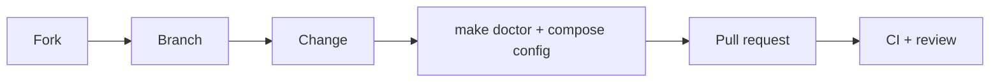

# Contributing

Thanks for helping improve `local-sonarqube`. Small, focused changes are easiest to review.

## Ground rules

- Be kind. See [CODE_OF_CONDUCT.md](CODE_OF_CONDUCT.md).
- Open an issue before large changes so we can agree on direction.
- Keep the setup **local-only and secure by default**: web port bound to `127.0.0.1`, database not published to the host, no secrets committed.

## Development workflow



1. Fork the repo and create a branch from `main`:
   ```bash
   git checkout -b feat/short-description
   ```
2. Copy the env template and set a strong password:
   ```bash
   cp .env.example .env
   ```
3. Make your change, then validate it:
   ```bash
   docker compose --env-file .env.example config -q
   make doctor
   ```
4. Commit with a clear message (e.g. `fix: correct backup path`, `docs: clarify VS Code steps`).
5. Open a pull request and fill in the template.

## What to include in a PR

- What changed and why.
- How you tested it (OS, Docker version).
- Doc updates (`README.md`, `docs/`) if behavior changed.

## Never commit

- `.env` or any real credentials or tokens.
- Database backups or dumps.

## Reporting security issues

Do not open a public issue. See [SECURITY.md](SECURITY.md).

## License

By contributing, you agree your contributions are licensed under the [MIT License](LICENSE).
